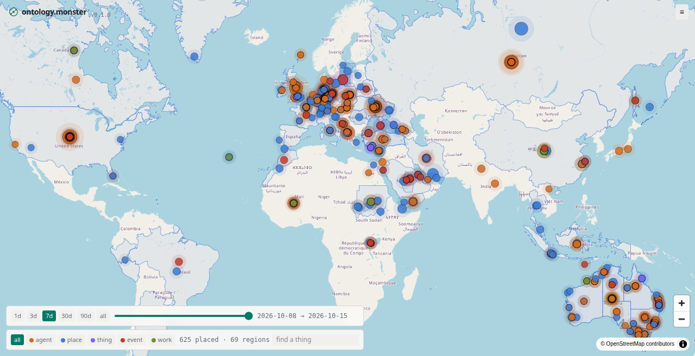

# ontology-scraper

A machine reads the news on a schedule, finds the real things each story is about, decides what kinds of things they are, and works out what parts those kinds share. Then it shows its working: the things on a map over time, the relationships between them as a graph, and the vocabulary of kinds and parts as it grows. Live at [ontology.monster](https://ontology.monster).



The deep goal is entity, prototype and component discovery with refactoring over time. Most knowledge graphs start from a fixed schema and fit the world into it. This one starts from the text, lets the kinds and parts emerge from what is actually written about, and revises them when they strain. It is a discovery tool for organising the concept space of what humans are doing, read one article at a time.

## What it shows

- **Map.** Every placed thing in a chosen window of time, coloured by kind. A time slider widens the window from a day to everything seen. Countries, provinces and seas draw as regions. Select a thing and its relations draw as lines to the things it supports, opposes, is in, or is part of.
- **Graph.** The same relationships as a force-directed network.
- **Prototypes.** The kinds the machine has proposed so far, with the things that belong to each, and the broader kinds above them: a container ship is a kind of ship.
- **Components.** The parts that kinds share, in the entity-component style: a person has a lifespan and roles; a place has a location and an extent; a vessel has a flag and a tonnage. Each component carries a label and a description so a reader can tell what it means.
- **Notes.** Dated plain-language notes for readers at [ontology.monster/notes](https://ontology.monster/notes), from `notes/`.
- **Sources and pipeline.** Which feeds are polled, what has been fetched, and where each document is in the pipeline.

## How a thing gets a kind

1. **Inhale.** Feeds are polled on a Poisson schedule with backoff. Articles are fetched, their text extracted, and stored with provenance. Bodies are stored for analysis and never served.
2. **Analyse.** A language model reads each article against a fixed schema: a summary, the tone, when it happened, every entity mentioned with its span, its top kind (agent, place, thing, event or work), a proposed prototype, aliases, where it was, and the relations between entities drawn from a short spine of predicates.
3. **Resolve.** Mentions become entities. Exact and alias matches merge; near matches go to a second model call to judge; prototypes become entities of their own; relations become bitemporal claims with the article as evidence.
4. **Enrich.** Entities are linked to Wikidata under conservative rules, so that homonyms stay apart. Countries, provinces and seas get their shapes from Natural Earth by Wikidata id. Text embeddings support search.
5. **Induce.** Once enough new prototypes exist, a census of what components each kind actually carries goes to a model, which proposes merges, a hierarchy, and new components. Proposals are recorded as proposals, not applied silently.

The five top kinds are fixed. Everything below them is data and can be rewritten, split or joined as the evidence changes. The reader note [how a thing gets a kind](notes/20261014-how-a-thing-gets-a-kind.md) tells this story at length.

## Sources

`config/sources.json` lists the feeds. Public broadcasters, wire-like outlets, the UN, a few science and trade journals, and a few government feeds are polled. Feeds whose terms forbid machine reading are seeded with `status: review` and left alone. Articles are read for analysis; the site shows summaries, entities and claims, with a link back to the source.

## Donated analysis

Analysis is the expensive step. `bin/chores.mjs` lets any contributor with a model, including a person, claim a batch of unanalysed documents, analyse them against the published schema, and submit the results, which are marked with the contributor's label and then resolved like any other analysis. The devlog entry on donated analysis explains the thinking and what is still open, including agreement between contributors as a source of confidence.

## Run

```
npm install
cp .env.example .env     # mongo, and a model key (ANTHROPIC_API_KEY or OPENROUTER_API_KEY); ollama is the free fallback
scripts/fetch-ne.sh      # Natural Earth boundaries into data/ne/ (public domain, not in git)
npm run seed             # sources, component definitions, top kinds
npm run once             # one pass of the pipeline
npm run worker           # the loop
npm run build && npm start   # the server on :8100
npm run dev              # the Vite dev server on :5174, proxied to :8100
```

Mongo is expected on localhost. Models are tried in order: the Anthropic API, OpenRouter, then a local ollama. Each phase can be pinned to a model with `MODEL_<PHASE>` or `OPENROUTER_MODEL_<PHASE>`, and `ANALYZE_BUDGET` caps documents analysed per day. `bin/rerun.mjs <phase>` marks a phase dirty after a prompt or schema change.

Deploy is manual and documented in `deploy/DEPLOYMENT.md`. Push is not deploy.

## Shape

`lib/store.mjs` is the only module that touches Mongo. `lib/pipeline.mjs` is the phase machinery: a status per document, claims with a lease, bounded retries, dirty marking. The phases are `lib/inhale` (poll, extract), `lib/analyze` (the prompt and schema), `lib/resolve` (mentions to entities, claims, relations, merges), `lib/enrich` (Wikidata link, extents, embeddings) and `lib/ontology` (component seeds, induction). `lib/service.mjs` is the read side, `server/index.mjs` the socket.io transport, `src/` the Svelte 5 app.

## Reading further

- The guiding light is Jessica Talisman's *Ontology Pipeline: A framework for building knowledge infrastructures* (Technics Publications; [ontologypipeline.com](https://www.ontologypipeline.com/), [publisher](https://technicspub.com/ontology-pipeline)). Its sequence, controlled vocabulary to metadata to taxonomy to thesaurus to ontology to knowledge graph, is the sequence the phases here follow; `devlog/20261014-survey-ontology.md` maps the stages onto the modules.
- `devlog/` is the working log, dated entries, newest last. The 2026-10-14 entries include three literature surveys (aggregation, extraction, ontology) and the architecture decisions. Read the tail first.
- `devlog/20261014-architecture.md` has the data model and module map.
- Continues [saltspring-ontology](https://github.com/anselm/saltspring-ontology) at world scale and takes its component model from [social-knowledge-service](https://github.com/anselm/social-knowledge-service).
